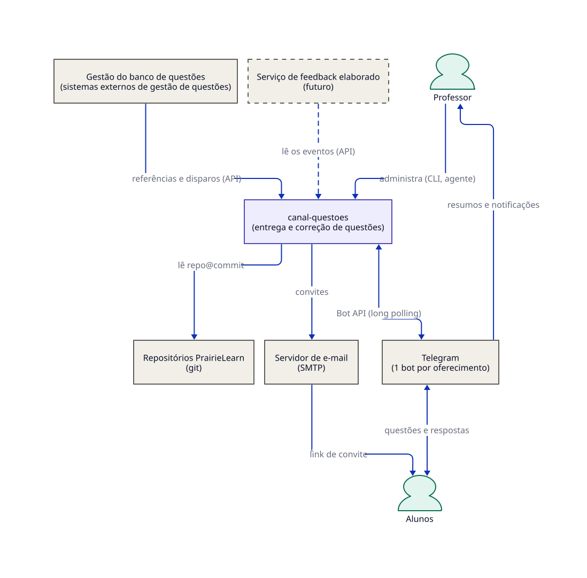

# canal-questoes

## Summary (in English)

canal-questoes delivers [PrairieLearn](https://www.prairielearn.com/) questions to students through Telegram bots, one
bot per course offering, for formative assessment in the messaging app students already use. Answers are graded with
PrairieLearn's own semantics: the question engine runs inside the official PrairieLearn image and reuses its code. The
instructor gets a descriptive report for each question sent and runs the system through an HTTP API with a
command-line client (`cq`) or through an AI agent, using an MCP server and a Claude Code plugin. Students appear only
under pseudonyms; their identity comes out only through an audited reveal operation. The system started as an
undergraduate final project in Computer Science at Unicamp (Brazil). The documentation and the command-line client are
in Brazilian Portuguese; issues and questions in English are welcome.

## O que é

O canal-questoes entrega questões do [PrairieLearn](https://www.prairielearn.com/) aos alunos por bots do Telegram, um
bot por oferecimento de disciplina, e corrige as respostas com a mesma semântica do PrairieLearn. O professor recebe um
relatório descritivo de cada questão enviada e opera o sistema pelo CLI `cq`, pela API ou por um agente de IA, pelo
servidor MCP e pelo plugin do Claude Code.

## Para quem

- **Professores** que usam questões do PrairieLearn e querem levá-las aos alunos como avaliação formativa, no
  aplicativo de mensagens que eles já usam, com a mesma correção do PrairieLearn.
- **Quem opera uma instalação**: a pilha local, com Docker Compose, ou um servidor próprio.
- **Pessoas desenvolvedoras e pesquisadoras** interessadas na entrega de questões por mensagem, na fidelidade ao
  PrairieLearn ou na operação de um sistema por agente.

Os alunos não instalam nada além do Telegram: eles só conversam com o bot do oferecimento.

## O que faz

- **Oferecimentos e bots.** Cada oferecimento de disciplina tem o seu bot do Telegram, criado pelo professor no
  BotFather e registrado no sistema.
- **Lista e convites.** A lista de alunos entra por um arquivo CSV; cada aluno recebe por e-mail um convite com um link
  que vincula a conta dele no Telegram ao oferecimento.
- **Disparos.** O professor escolhe uma questão de um repositório git do PrairieLearn, num commit fixo, e a janela em
  que ela fica aberta; o bot entrega a questão aos alunos vinculados e recebe as respostas no próprio chat.
- **Correção fiel ao PrairieLearn.** O motor de questões roda dentro da imagem oficial do PrairieLearn e corrige com o
  código dele. Ele aceita cinco elementos de resposta (`pl-multiple-choice`, `pl-checkbox`, `pl-number-input`,
  `pl-integer-input` e `pl-string-input`) e alguns elementos de painel e de exibição, como `pl-question-panel`,
  `pl-figure` e `pl-code`; uma questão com um elemento fora desse conjunto é recusada na inspeção, com o motivo. A
  lista completa está na [referência dos tipos de questão](docs/referencia/tipos-de-questao.md). A única diferença
  deliberada: num `pl-number-input`, uma resposta com uma só vírgula e nenhum ponto (como `3,14`) é lida como
  `3.14`.
- **Relatórios.** Cada disparo tem um relatório descritivo da questão: o alcance, o desempenho, o tempo de resposta, a
  distribuição das respostas e a fricção (os erros de formato e o uso da vírgula decimal). O relatório é congelado
  quando o disparo fecha, e a equipe do oferecimento (quem entra no bot pelo link de equipe, gerado por
  `cq team link`) recebe os resumos pelo Telegram.
- **Privacidade por construção.** Os alunos aparecem só por pseudônimo. O nome, o RA e o e-mail saem apenas pela
  operação de revelação (`cq identity reveal`), que pede uma justificativa e fica registrada; a conta do Telegram do
  aluno não sai por nenhuma operação.
- **Operação pela API, pelo CLI e por agente.** Cada operação da API nasce num catálogo único, com o endpoint, o
  comando do `cq` e, quando faz sentido, a ferramenta do servidor MCP (`cq mcp`); o `cq` e o servidor MCP também
  operam a pilha local. As operações destrutivas, como o expurgo de um oferecimento, passam por duas fases: preparar e
  confirmar. O plugin do Claude Code traz o servidor MCP e as skills dos fluxos do professor.

## Estado do projeto

A versão atual é a **v0.1.2**. A primeira pública foi a **v0.1.0**. O piloto com alunos de uma disciplina da
**Unicamp** ainda não começou; quando começar, ele vai rodar o código desta versão. As versões seguem o
[SemVer](https://semver.org/lang/pt-BR/) na faixa
0.y.z: até a 1.0.0, a API, o CLI e os formatos ainda podem mudar de uma versão para outra, e o
[CHANGELOG](CHANGELOG.md) registra cada mudança. Os próximos passos estão no [ROADMAP](ROADMAP.md).

Por enquanto, o desenvolvimento do dia a dia acontece num repositório privado, e este repositório recebe o código de
cada versão por uma pull request própria.

O badge do CI mostra o resultado do workflow de CI: a suíte Python rápida (sem os testes de sistema) roda a cada push
e a cada pull request, e a suíte Python inteira, com os testes de sistema, roda a cada push na `main`. A suíte do motor
e a conformidade com o PrairieLearn rodam num workflow próprio, que não entra neste badge.

O badge da cobertura mostra a fração das linhas do servidor (`server/src/cq_server`) e do cliente
(`client/src/cq_client`) executadas pela suíte rápida. O coverage mede essas linhas no processo do pytest e nos
subprocessos que herdam o ambiente dele, e por isso o número fica subestimado: os subprocessos iniciados com um
ambiente próprio ficam de fora. O motor em TypeScript e as
ferramentas de operação não entram na conta.

## Como começar

O caminho mais curto é o [tutorial de primeiro uso](docs/tutorial/primeiro-uso.md). Ele leva da cópia do repositório
até o relatório de uma questão que você mesmo responde no Telegram, com dados fictícios, e termina limpando tudo.

Você vai precisar de:

- Linux, ou Windows com o WSL 2;
- Docker com o Compose, git e o [`uv`](https://docs.astral.sh/uv/);
- uma conta do Telegram e um bot criado no BotFather;
- um servidor SMTP para os convites por e-mail (por exemplo, a sua conta de e-mail com uma senha de app);
- uma questão do PrairieLearn num repositório git público, servido por HTTPS (o endereço, o SHA do commit e o caminho
  da questão).

O caminho, em resumo:

1. Clone o repositório e, na raiz dele, instale o CLI com `uv tool install ./client`.
2. Crie o `.env` da pilha na raiz do repositório, a partir do `.env.example`, e o arquivo de perfil do `cq`, fora do
   repositório.
3. Suba a pilha local com `cq up` e confira tudo com `cq doctor`.
4. Crie um oferecimento (`cq offerings create`), registre e ative o bot (`cq bots register` e `cq bots activate`),
   importe uma lista de alunos com você mesmo como aluno de teste (`cq students import`) e envie os convites
   (`cq invites send prepare`, depois `cq invites send confirm`). Abra o link do convite que chegar no seu e-mail,
   para vincular a sua conta do Telegram ao oferecimento.
5. Prepare e confirme um disparo (`cq dispatches prepare` e `cq dispatches confirm`) e leia o relatório
   (`cq reports show`).

O [início rápido](docs/operacao/inicio-rapido.md) detalha a instalação do `cq`, o `.env` e o arquivo de perfil.

## Documentação

O [índice da documentação](docs/README.md) organiza os textos em quatro tipos:

- **Tutorial:** o [primeiro uso](docs/tutorial/primeiro-uso.md), do zero ao primeiro relatório.
- **Guias de operação**, em [`docs/operacao/`](docs/operacao/): o [início rápido](docs/operacao/inicio-rapido.md), a
  [implantação numa VM](docs/operacao/implantacao-vm.md), o
  [backup e a restauração](docs/operacao/backup-e-restauracao.md), a
  [política de retenção](docs/operacao/politica-de-retencao.md), o
  [CI e a exportação](docs/operacao/ci-e-exportacao.md), a [observabilidade](docs/operacao/observabilidade.md), o
  [plugin e o agente](docs/operacao/plugin-e-agente.md) e a
  [publicação de versões](docs/operacao/publicacao-de-versoes.md). O início rápido, a implantação na VM, o backup e a
  restauração, a política de retenção e o CI e a exportação foram escritos para quem opera o piloto.
- **Referência:** o [CLI](docs/referencia/cli.md), a [API](docs/referencia/api.md), o [MCP](docs/referencia/mcp.md) e
  os [tipos de questão](docs/referencia/tipos-de-questao.md).
- **Explicação:** a [arquitetura](docs/explicacao/arquitetura.md), o [método](docs/explicacao/metodo.md), os
  [princípios](docs/explicacao/principios.md) e as [decisões](docs/explicacao/decisoes.md).

Os [diagramas](docs/diagramas/README.md) da arquitetura e do método ficam em `docs/diagramas/`, com os arquivos-fonte
em D2 e os SVGs gerados a partir deles.

## Como contribuir

Contribuições são bem-vindas. O [`CONTRIBUTING.md`](CONTRIBUTING.md) explica como preparar o ambiente, rodar os testes
e escrever os commits, e traz a política de testes (os testes vêm primeiro, e um teste existente não muda para o código
passar) e a política de contribuições feitas com IA. A participação segue o [código de conduta](CODE_OF_CONDUCT.md).

- **Dúvidas:** nas Discussions, como descreve o [`SUPPORT.md`](SUPPORT.md).
- **Defeitos e melhorias:** nas Issues, pelos formulários.
- **Agentes de código:** o [`AGENTS.md`](AGENTS.md) resume o projeto, as suítes e as regras para qualquer agente; o
  [`CLAUDE.md`](CLAUDE.md) acrescenta o que é próprio do Claude Code.

Relatos e perguntas em inglês também são aceitos.

## Segurança

Não relate vulnerabilidades em issues, discussões ou pull requests públicas. Use o relato privado descrito na
[política de segurança](SECURITY.md), que também lista as versões suportadas; a primeira resposta sai em até 14 dias.

## Licença

O canal-questoes é software livre, distribuído sob a GNU Affero General Public License, versão 3 ou qualquer versão
posterior (**AGPL-3.0-or-later**). O texto da licença está em [`LICENSE`](LICENSE).

**Nota sobre o PrairieLearn.** O motor de questões roda dentro da imagem Docker oficial do PrairieLearn, fixada por
commit e por digest, e reutiliza, sem alteração, código dele: os elementos do PrairieLearn e as peças que executam o
código Python de cada questão e montam o HTML dela. Esse código não é copiado para este repositório: ele vem da imagem,
baixada na construção do motor. Além disso, o motor reproduz em TypeScript algumas funções do PrairieLearn, como a
sequência das fases da questão, a conferência dos dados da questão, o cálculo da nota e as regras do `info.json`, com a
origem indicada no cabeçalho de cada arquivo em [`engine/src/pl/`](engine/src/pl/). A edição comunitária do
PrairieLearn, de onde vem o código reutilizado, é distribuída sob a AGPL-3.0, e a licença deste projeto foi escolhida
para ser compatível com esse reuso.

## Como citar

Se você usar o canal-questoes num trabalho acadêmico, cite-o pelos metadados do [`CITATION.cff`](CITATION.cff). Na
página do repositório, o GitHub mostra a citação pronta em "Cite this repository".

## Agradecimentos

Ao Prof. Rodolfo Azevedo, orientador deste trabalho, e ao Instituto de Computação da Unicamp (IC/Unicamp). Ao projeto
PrairieLearn, cujo motor e cujos elementos este sistema reutiliza.

## Mantenedor

O canal-questoes tem um mantenedor: **Pedro Ribeiro**, aluno de Ciência da Computação no IC/Unicamp, autor do trabalho
de conclusão de curso em que o sistema nasceu. Dúvidas e relatos seguem os canais do [`SUPPORT.md`](SUPPORT.md); as
vulnerabilidades, a [política de segurança](SECURITY.md).
