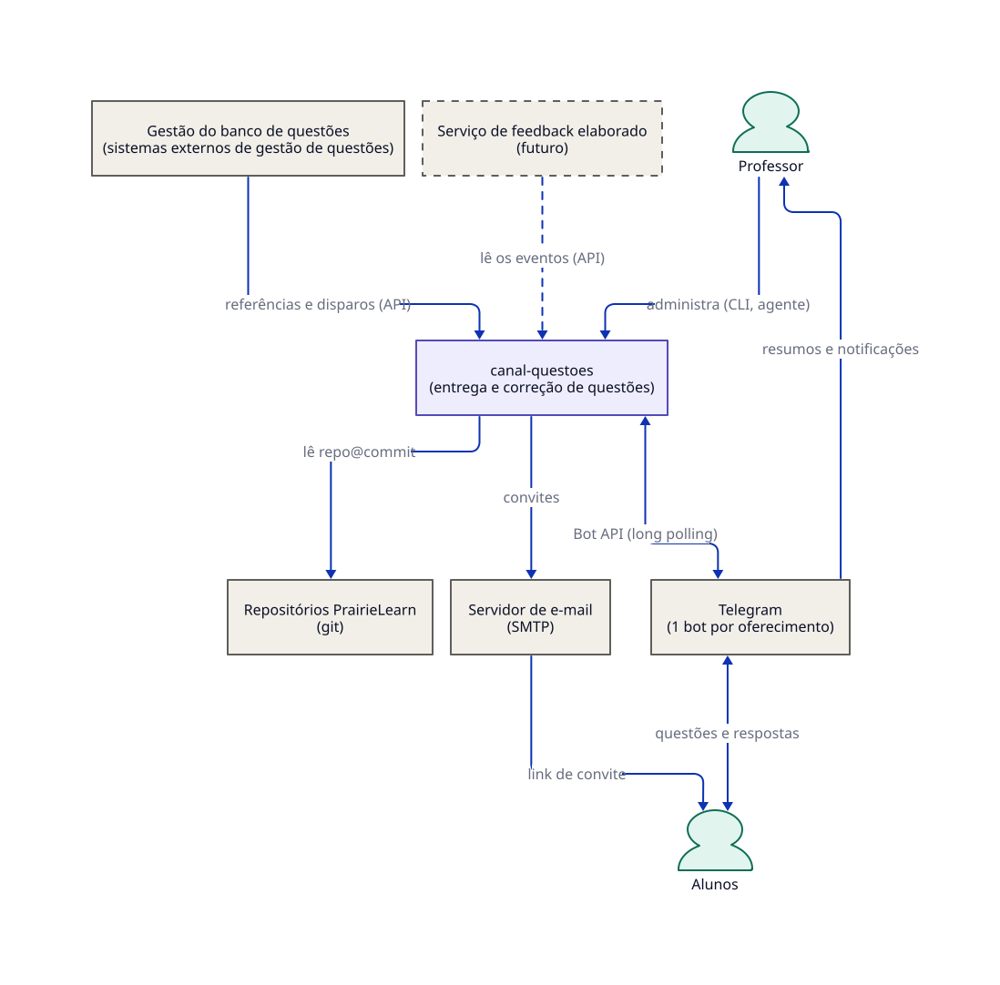
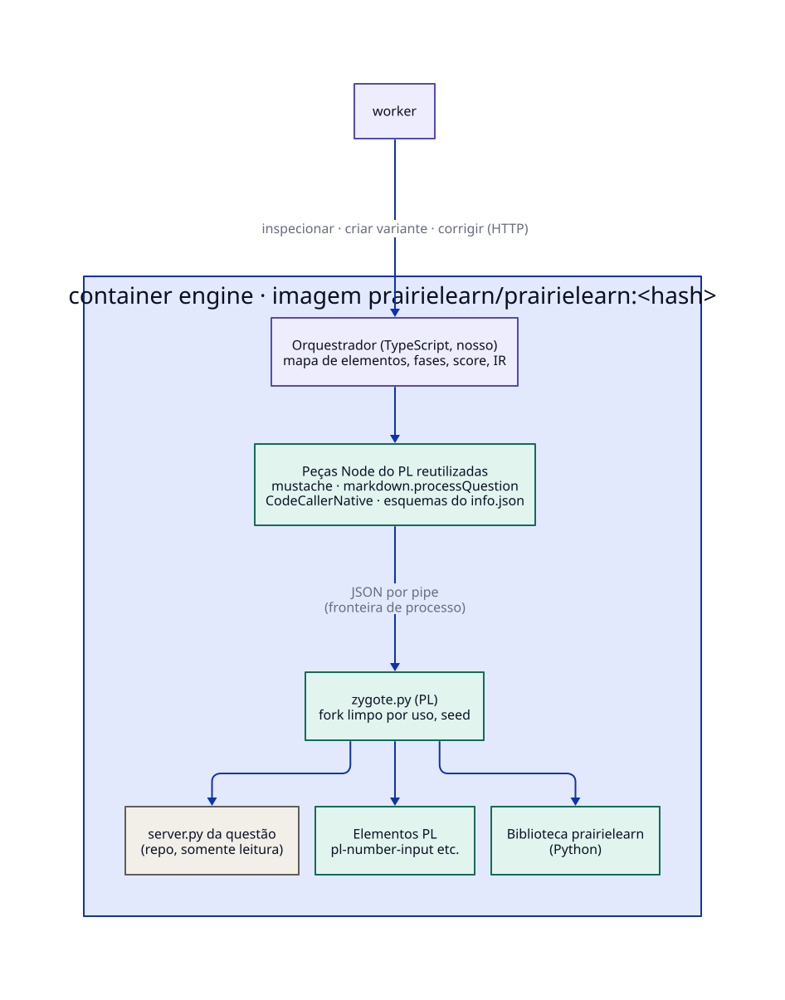
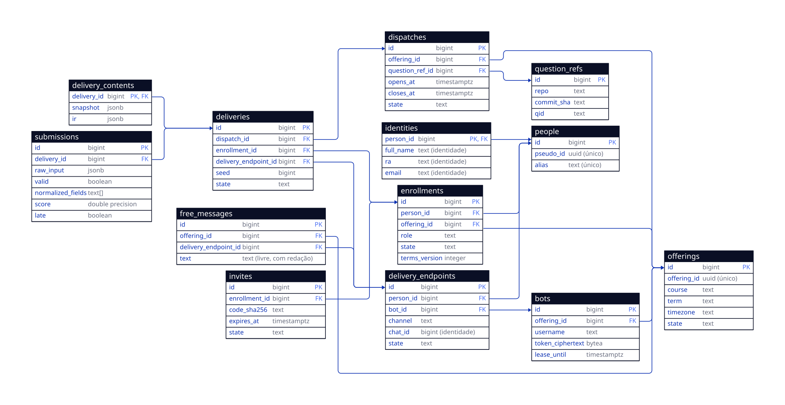
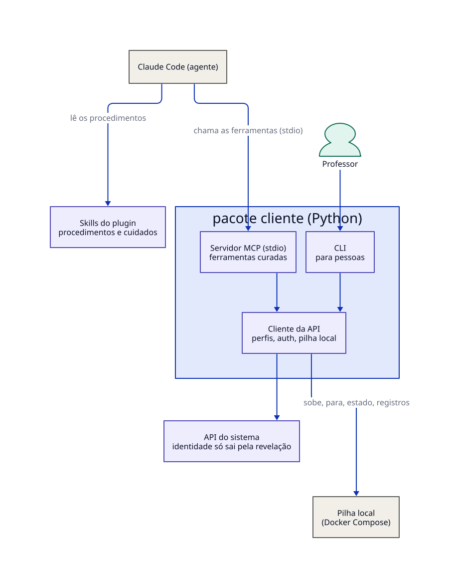
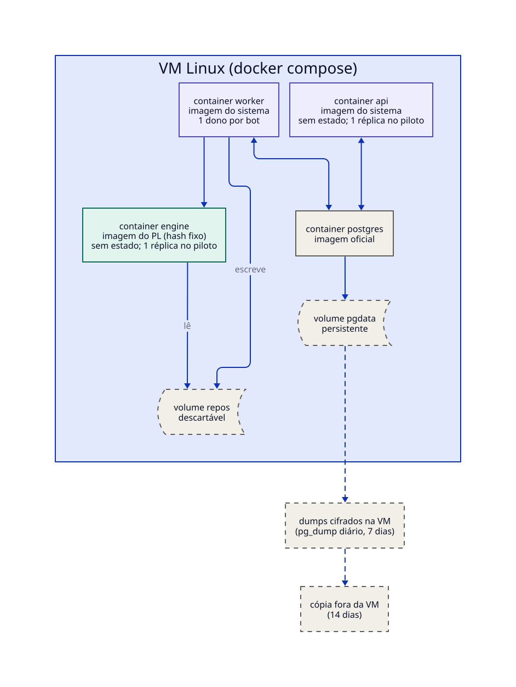

# Arquitetura

Este texto explica como o canal-questoes se organiza. Cada parte é descrita primeiro pela intenção e só depois pela
tecnologia que a implementa, para que a troca de uma tecnologia não mude a arquitetura. A apresentação segue os níveis
de abstração do modelo C4: primeiro o contexto do sistema, depois os contêineres e, no caso do motor de questões, os
componentes internos.

O texto foi adaptado da seção de arquitetura da monografia do projeto e descreve o que existe no código desta versão;
o que ficou para depois aparece como evolução. As razões das escolhas principais e as alternativas descartadas estão
em [Decisões de projeto](decisoes.md); os princípios que a arquitetura protege, em [Princípios](principios.md). Os
diagramas ficam em [`docs/diagramas/`](../diagramas/README.md), com o fonte em D2 ao lado de cada SVG.

## Contexto

O sistema tem dois tipos de usuário e se relaciona com cinco sistemas externos.

- **O professor** administra os oferecimentos de disciplina e os disparos de questões pela linha de comando (`cq`) ou
  por um agente de IA. Ele e a equipe do oferecimento recebem os resumos e os avisos no chat do bot da disciplina,
  depois de se vincularem a ele por um link de equipe (`cq team link`).
- **Os alunos** recebem um convite individual por e-mail e, com ele, se vinculam ao bot do oferecimento. A partir daí,
  recebem e respondem as questões no próprio Telegram.

Os sistemas externos:

- os sistemas que geram e gerem as questões podem enviar as referências e os pedidos de disparo pela API do sistema;
- os cursos do PrairieLearn fornecem o código de cada questão: um repositório git remoto ou, enviado pelo operador,
  uma pasta de curso do computador dele, com ou sem git;
- a Bot API do Telegram e um servidor de e-mail (SMTP) são os meios de entrega;
- um serviço de feedback elaborado, previsto para o futuro, poderá ler os eventos do sistema pela API.

Uma propriedade do contexto orienta o resto da arquitetura: **o banco de questões é opaco para o sistema**. O
canal-questoes não edita, não gera nem interpreta questões. Ele recebe só referências imutáveis, formadas pelo banco,
pela versão fixada e pelo identificador da questão no curso (o QID), e entrega o conteúdo ao motor. O banco chega de
duas formas:

- um repositório git, por uma URL `https`, num *commit*;
- um banco enviado pelo operador, com a referência `bank:<nome>`: o CLI ou o servidor MCP leem a pasta do curso ou um
  *commit* de um git local, empacotam e enviam à API, e o servidor guarda o pacote, imutável, identificado pelo hash
  SHA-256 do conteúdo, que faz o papel do *commit*. Só o cliente lê o git local; o núcleo continua sem git.

A referência aponta o curso inteiro, e não só a pasta da questão, porque uma questão pode depender de bibliotecas e de
elementos definidos no nível do curso. Fixar a versão torna o disparo reprodutível, mesmo que a questão mude depois
no repositório ou na pasta do operador.

## Contêineres e comunicação

O sistema é formado por quatro contêineres, orquestrados pelo Docker Compose ([`compose.yaml`](../../compose.yaml)).

| Contêiner | Imagem | Papel |
| --- | --- | --- |
| `api` | a do sistema (Python 3.12, FastAPI) | a API HTTP de administração, das integrações, dos relatórios e da revelação de identidade; não guarda estado e nunca fala com o motor |
| `worker` | a mesma imagem da `api` | recebe as atualizações do Telegram, agenda e consome as tarefas, envia as mensagens e os e-mails, obtém os repositórios de questões (baixa do git ou publica o banco enviado) e chama o motor |
| `engine` | a oficial do PrairieLearn, com o orquestrador do sistema | executa as questões; não guarda estado, não acessa a rede externa e roda sem privilégios |
| `postgres` | a oficial do PostgreSQL 18 | guarda o estado, o log de eventos, as filas e os pacotes dos bancos enviados |

A comunicação entre eles, pela intenção, com a implementação entre parênteses:

- a API e o worker se comunicam por filas de trabalho (tabelas do PostgreSQL consumidas com
  `SELECT ... FOR UPDATE SKIP LOCKED`, que deixa vários consumidores disputarem a mesma fila sem esperar uns pelos
  outros);
- o worker é avisado das mudanças de configuração, como a ativação de um bot (com `LISTEN` e `NOTIFY`, cujo aviso só
  é entregue depois que a transação é confirmada);
- o worker chama o motor por requisições HTTP síncronas, numa rede interna só dele e do motor;
- o motor lê os repositórios de questões de um volume montado só para leitura; quem os põe lá é o worker, o único
  que escreve nesse volume: ele baixa os repositórios do git e publica os bancos enviados a partir do pacote guardado
  no PostgreSQL.

A API é publicada só no endereço local do host (`127.0.0.1`, porta 8000 por padrão, mudada por `CQ_API_PORT`). O
acesso de outra máquina, pela linha de comando ou pelo agente, passa por um túnel SSH, com um perfil remoto.

A divisão é a de um **monólito modular com um único serviço à parte**. A API e o worker compartilham o mesmo código de
domínio e o mesmo banco. Isso permite operações atômicas, como gravar a variante de um aluno e pôr na fila as
mensagens dela numa só transação. O motor fica separado por três razões:

- depende de outro ambiente de execução, o da imagem do PrairieLearn, com o Node.js e o Python das bibliotecas do PL;
- executa código de terceiros, inclusive código gerado por modelos de linguagem;
- tem um ciclo de versão próprio, ditado pela versão fixada do PrairieLearn.

O isolamento do motor decorre da segunda razão. No `compose.yaml`, o contêiner do motor:

- fica ligado só a uma rede interna, sem saída para a Internet e sem acesso aos serviços do host;
- não publica porta nenhuma;
- tem o sistema de arquivos só para leitura, com o `/tmp` em memória;
- roda com um usuário sem privilégios, sem capacidades do núcleo do sistema operacional e sem ganho de privilégios;
- tem limites de memória, de processador e de número de processos, configuráveis (`CQ_ENGINE_MEM_LIMIT`,
  `CQ_ENGINE_CPUS`, `CQ_ENGINE_PIDS_LIMIT`).

Esse isolamento protege o resto do sistema, mas não separa as questões umas das outras. O código de uma questão pode
ler os outros repositórios montados e, nos pedidos simultâneos, dados de outros alunos, e devolver isso no enunciado,
no feedback ou nos erros de formato. Por isso o sistema só aceita repositórios de hosts permitidos
(`CQ_REPO_ALLOWED_HOSTS`; vazia, recusa todos) e bancos enviados com um token que tenha a permissão de escrita
(`offerings:write`), e deve receber só questões de autores confiáveis. Executar questões de
autores não confiáveis exigiria um usuário separado para o código da questão, o que fica como trabalho futuro.

## Núcleo, portas e adaptadores

O núcleo reúne as regras de oferecimentos, vínculos, disparos e relatórios. Ele não depende diretamente de Telegram,
PrairieLearn, git, e-mail ou HTTP. Cada dependência externa entra por uma **porta**, uma interface definida pelo
núcleo, e é atendida por um **adaptador**, no padrão de portas e adaptadores (a arquitetura hexagonal). Um teste de
contrato confere que os módulos do núcleo não importam bibliotecas HTTP, a camada da API nem os adaptadores.

| Porta | Adaptadores nesta versão | Evolução prevista |
| --- | --- | --- |
| motor de questões (`QuestionEngine`) | o cliente HTTP do motor PrairieLearn | uma reimplementação de um subconjunto do PL; outros formatos de questão |
| canal de entrega (`DeliveryChannel`) | o Telegram; o console, para testes | outros mensageiros |
| canal de verificação (`VerificationChannel`) | o e-mail, por SMTP | SMS, WhatsApp |
| obtenção de repositórios (`RepoFetcher`) | o git, por `https`; a publicação dos bancos enviados, a partir do pacote guardado | — |
| dialeto do canal (`MessageFormatter`) | a formatação do Telegram nos modos `rich` e `html`; o texto puro, no console | — |
| sonda do servidor de e-mail (`MailServerProbe`) | o teste de conexão do SMTP, sem envio | — |
| relatórios (`ReportRenderer`) | o JSON, o CSV e o resumo no chat do bot | o relatório formatado |
| Bot API do Telegram (`TelegramBotApi`) | o cliente HTTP da Bot API | — |

Os bots são criados à mão no BotFather e registrados pelo token (`cq bots register`). A criação automática dos bots
ficou como evolução e não tem porta própria no código desta versão.

Os canais de entrega declaram as suas **capacidades**: editar uma mensagem já enviada, o número de botões que aceitam,
a exibição de fórmulas e a formatação rica. O núcleo adapta a interação a essas capacidades, em vez de perguntar qual
canal está em uso. O console não edita nem tem botões; no Telegram, as capacidades dependem do modo de formatação
(`CQ_TELEGRAM_FORMAT`): no `rich`, o padrão, há fórmulas e formatação rica; no `html`, não. O adaptador de console
permite exercitar o fluxo inteiro, do disparo à correção, sem o Telegram. Isso realiza a intenção original do padrão:
deixar que a aplicação seja conduzida igualmente por pessoas, por programas e por testes automatizados.

## Motor de questões

O motor tem uma única responsabilidade: **executar questões PrairieLearn com fidelidade**. Ele oferece três operações
por HTTP (`/v1/inspect`, `/v1/variants` e `/v1/grade`), descritas em
[`contracts/engine/v1/`](../../contracts/engine/v1/).

| Operação | Entrada | Saída |
| --- | --- | --- |
| inspecionar | a referência da questão | os metadados (título, tópico, elementos usados, regras de exibição do gabarito) e o veredito de suporte, com o motivo quando a questão não é suportada |
| criar variante | a referência, a semente e as preferências | o instantâneo da variante (semente, parâmetros, respostas corretas, versões do motor e do PL) e a representação intermediária, que inclui o gabarito para exibição |
| corrigir | a referência, o instantâneo e as respostas do aluno | os erros de formato por campo ou, se a resposta é válida, a resposta interpretada, as notas parciais, a nota (normalmente de 0 a 1, como o PL a calcula) e o feedback gerado pelo PL |

A fronteira do motor importa tanto quanto as operações. Ele não guarda estado, não escolhe a questão nem a semente,
não baixa repositórios e não conhece alunos, prazos ou canais. Também não decide quando mostrar o gabarito e não
formata mensagens. Assim, a mesma referência com a mesma semente produz a mesma variante, desde que na mesma imagem do
PrairieLearn e que a questão tire o acaso dos geradores que o PL semeia (`random` e `numpy.random`).

O PrairieLearn não oferece um serviço de questões que possa ser usado como caixa-preta: a API pública dele não cria
variantes nem corrige respostas. Por isso o motor reutiliza o PL num nível intermediário, cuja escolha está em
[Decisões de projeto](decisoes.md#como-reutilizar-o-prairielearn). Um orquestrador escrito em TypeScript roda dentro
da imagem oficial do PrairieLearn, fixada pelo *commit* do PL e pelo resumo criptográfico (*digest*) da imagem.

O orquestrador reutiliza, sem alteração, peças do próprio PL, entre elas:

- a biblioteca de *templates* Mustache, na mesma versão;
- o processamento de Markdown das questões;
- o componente `CodeCallerNative`, que executa o código Python das questões em processos isolados;
- os esquemas com que o PL valida o `info.json` da questão e dos elementos.

Todo o código Python do PL também é reutilizado sem alteração: os elementos, a biblioteca `prairielearn` e o processo
*zygote*, que cria um processo limpo a cada uso. O orquestrador implementa só o que não pode ser reaproveitado
isoladamente:

- o mapa de elementos;
- a sequência das fases de geração, preparação, interpretação e correção, espelhando o código do servidor do PL;
- o cálculo da nota;
- a produção da representação intermediária.

O motor é escrito em TypeScript, e não em Python como o resto do sistema, por um detalhe de fidelidade: a biblioteca
Mustache que o PL usa, em JavaScript, escapa mais caracteres do que a biblioteca Python equivalente, e reimplementar a
renderização em Python mudaria o HTML entregue aos elementos.

A fidelidade é verificada contra um **oráculo**: uma instância local do PrairieLearn, na mesma versão, em modo de
desenvolvimento. Ela é acionada pelos mesmos formulários web que o professor usa para testar uma questão, gera a
variante com a mesma semente e corrige as mesmas respostas. Uma suíte de conformidade, em
[`engine/conformance/`](../../engine/conformance/), compara os resultados dela com os do motor. As questões e os
elementos suportados estão em [Tipos de questão](../referencia/tipos-de-questao.md).

## Representação intermediária

O motor não entrega ao canal o HTML do PrairieLearn. Ele entrega uma **representação intermediária** (IR), um
documento JSON versionado que é o contrato entre o motor e os canais
([`ir.schema.json`](../../contracts/engine/v1/ir.schema.json)). A versão 1.0 tem cinco partes:

- **enunciado:** HTML num subconjunto canônico (parágrafos, ênfase, código, listas, tabelas, imagens e fórmulas em
  LaTeX), em que cada campo de resposta aparece como um marcador próprio (`<cq-field>`). O subconjunto é próximo do
  HTML aceito pelas mensagens ricas do Telegram. Um canal sem algum desses recursos degrada o que não suporta;
- **campos:** cada campo de resposta, na ordem do documento, com o tipo (número, inteiro, texto, escolha única ou
  escolha múltipla), o rótulo, o sufixo, a dica de formato, as restrições e o peso. Nas escolhas, cada opção traz a
  chave, o HTML e um *hash* do conteúdo;
- **gabarito:** para cada campo, o valor correto, a forma de exibição e se ele pode ser mostrado ao aluno;
- **explicação:** o conteúdo do painel de resposta da questão, quando existe;
- **mídias:** as imagens referenciadas pelo enunciado, estáticas ou geradas pela questão, já resolvidas.

O *hash* do conteúdo das opções existe porque, no PrairieLearn, as letras das alternativas são atribuídas depois do
embaralhamento: a alternativa "b" de um aluno pode ser a "d" de outro. Com o *hash*, o relatório conta quantos alunos
escolheram cada distrator, mesmo com variantes diferentes.

## O caminho de uma questão

Um disparo atravessa os contêineres assim:

1. **Preparo.** A API recebe o pedido de disparo (a referência, a abertura e o fechamento), grava-o e enfileira a
   validação; ela nunca chama o motor. Sem horário de abertura, o disparo é imediato.
2. **Validação.** O worker obtém a versão fixada da questão (baixa o *commit* do git ou publica o banco enviado),
   pede ao motor a inspeção e uma variante de amostra. Uma questão não suportada rejeita o disparo.
3. **Confirmação.** Validado, o disparo espera a confirmação do operador, a segunda das duas fases. Antes da
   abertura, o operador pode cancelar o disparo (`cq dispatches cancel`), e o disparo validado e não confirmado no
   prazo expira.
4. **Entrega.** Na abertura, o worker cria a variante de cada aluno, fora de transação, e depois grava numa só
   transação o conteúdo, as mídias e as mensagens na fila. A fila envia as mensagens pelo bot do oferecimento, no
   ritmo que o Telegram admite.
5. **Resposta.** Cada atualização do Telegram é gravada antes de o sistema confirmar a leitura ao Telegram e antes de
   ser processada, para que nenhuma resposta se perca. O worker corrige a resposta pelo motor e devolve ao aluno a
   correção direta. Se o motor está fora do ar, a submissão espera e é corrigida depois, sem limite de tentativas.
6. **Fechamento.** No fim da janela, quem respondeu ou escolheu "Não sei" recebe o gabarito, quando a questão permite
   mostrá-lo; a mensagem de quem não respondeu é fechada sem ele. O sistema congela o relatório do disparo e envia o
   resumo ao chat da equipe.

Os estados de cada entrega estão no diagrama [`estados-entrega`](../diagramas/estados-entrega.svg).

## Dados e privacidade

O modelo de dados separa quem a pessoa é do que ela faz no sistema:

- no banco, as entidades de uso (matrículas, endereços de entrega, convites e entregas) referenciam a pessoa por uma
  chave interna, sem relação com dado pessoal; fora dele (na API, nas ferramentas do agente e nos eventos), a pessoa
  aparece só por um **pseudônimo aleatório** (um UUID v4 sorteado, com um apelido curto derivado dele), nunca derivado
  do RA ou de outro dado pessoal;
- o nome, o RA e o e-mail ficam numa área restrita, lida só pela operação de revelação;
- o identificador do aluno no Telegram, necessário para entregar as mensagens, fica no endereço de entrega, de uso
  interno do worker. As atualizações do Telegram são minimizadas na entrada, por uma lista de campos permitidos.

Todo passo relevante gera um evento num **log em que só se acrescentam registros**: o banco recusa a alteração, a
remoção e o esvaziamento da tabela. Esse log também é o ponto de extensão para o serviço de feedback elaborado, que
pode lê-lo pela API, por tipo de evento e a partir de um cursor (`cq events list`).

A identidade pode entrar no sistema, por exemplo na importação da lista de alunos, mas **só sai por um endpoint de
revelação**. Esse endpoint:

- exige uma permissão específica no token de acesso (`identity:reveal`);
- recebe um escopo mínimo: uma lista de até 100 pseudônimos e uma justificativa;
- registra na trilha de auditoria quem pediu e quais pseudônimos foram revelados, sem gravar os nomes; o pedido
  negado também fica registrado.

Três mecanismos impedem que a identidade saia por outro caminho:

- os esquemas de saída da API e das ferramentas do agente são estritos e marcam os campos de identidade pelo tipo;
- um teste canário, com identidades fictícias, falha se qualquer saída que não seja a revelação contiver uma delas;
- todo texto livre que sai do sistema, como as mensagens espontâneas dos alunos, passa por redação automática: o
  nome completo, o RA e o e-mail de cada pessoa conhecida viram uma marca com o apelido dela, e os segredos viram
  `[segredo]`.

Os tokens dos bots ficam cifrados no banco (AES-256-GCM, com a chave derivada da chave-mestra `CQ_MASTER_KEY`); dos
tokens de acesso à API, o banco guarda só o resumo SHA-256. Nenhum segredo é guardado no repositório nem passa pelo
modelo de linguagem. Os registros que a operação lê (`cq logs`) são redigidos, e os do motor, que o código das
questões pode escrever, não são coletados por nenhuma saída do sistema. Depois que um oferecimento é arquivado, uma
operação própria, em duas fases, expurga as identidades dos seus alunos; a [política de
retenção](../operacao/politica-de-retencao.md) diz o prazo.

Essas regras respondem a três pressões:

- a proteção dos dados pessoais dos alunos, regida pela Lei Geral de Proteção de Dados Pessoais (LGPD). A separação
  entre a identidade e o pseudônimo segue a ideia de pseudonimização da lei (art. 13, parágrafo 4º), em que o dado só
  pode ser associado a uma pessoa com uma informação adicional mantida à parte, em ambiente controlado;
- a possível submissão de uma pesquisa com os dados a um comitê de ética;
- a operação por agentes de IA, que enviam ao provedor do modelo tudo o que as ferramentas devolvem.

## Operação por agente

Pessoas e agentes de IA operam o sistema pelo mesmo caminho. Um único pacote cliente, em Python, reúne a linha de
comando (`cq`), para pessoas, e um servidor MCP (*Model Context Protocol*), para agentes (`cq mcp`). Os dois
compartilham o cliente da API, os perfis de acesso, locais e remotos, e a autenticação. O servidor MCP também opera a
pilha local de contêineres: consulta o estado, sobe, para e lê os registros, já redigidos. Ele se comunica com o
agente pela entrada e saída padrão (*stdio*).

Toda operação da API entra num **catálogo único** ([`catalog.json`](../../contracts/api/v1/catalog.json)), que liga
cada uma ao endpoint, ao comando `cq` e, quando faz sentido, à ferramenta MCP
([`tools.json`](../../contracts/mcp/v1/tools.json)). As ferramentas expostas ao agente são curadas por caso de uso, e
não geradas automaticamente da API. A versão 1 do contrato tem 38 ferramentas: 33 operações do catálogo e 5 da pilha
local.

No agente, as operações com efeito difícil de desfazer são feitas em **duas fases**: preparar, que mostra o efeito,
e confirmar. São cinco: arquivar um oferecimento, enviar os convites, confirmar um disparo, expurgar as identidades e
parar a pilha. Na linha de comando, o `cq down` para a pilha direto, sem pedir confirmação. As ferramentas de
confirmação levam a anotação `destructiveHint` do protocolo e, como a ferramenta de revelação, a marca
`anthropic/requiresUserInteraction`, com que o Claude Code pede a confirmação do operador a cada chamada.
Os procedimentos operacionais, como criar um oferecimento ou disparar uma questão, são descritos em *skills*. As
skills e a configuração do servidor são distribuídas num plugin do Claude Code mantido no repositório
([`plugins/`](../../plugins/)); o guia está em [Plugin e agente](../operacao/plugin-e-agente.md).

As regras de identidade valem também para o agente:

- as ferramentas do dia a dia devolvem só pseudônimos;
- a revelação é uma ferramenta própria, que exige a confirmação do operador e fica auditada, mantendo uma pessoa no
  circuito, capaz de negar a chamada;
- a importação da lista de alunos recebe o caminho do arquivo, e não o conteúdo dele, para que os dados pessoais não
  passem pelo modelo;
- ficam só na linha de comando o registro do token de um bot, a gestão dos tokens de acesso, o link de equipe e o
  cadastro avulso de uma pessoa, porque envolvem segredos ou identidade, e a leitura das mensagens livres dos alunos,
  que são texto escrito por eles. Também fica fora do agente a verificação simples de saúde da API (`cq health`),
  coberta pelo diagnóstico completo (`cq doctor`), que o agente pode rodar.

## Implantação e escala

O sistema é implantado com o Docker Compose numa máquina virtual Linux. As imagens de base, inclusive a do
PrairieLearn, são fixadas pelo resumo criptográfico. Os segredos entram por variáveis de ambiente, num arquivo `.env`
mantido fora do git:

- a senha do banco (`CQ_DB_PASSWORD`);
- a chave-mestra que cifra os tokens dos bots (`CQ_MASTER_KEY`);
- a senha do servidor de e-mail (`CQ_SMTP_PASSWORD`);
- o token inicial de administração (`CQ_ADMIN_TOKEN`).

O repositório traz um modelo parcial desse arquivo (`.env.example`), sem a chave-mestra nem as variáveis do e-mail;
o [guia da máquina virtual](../operacao/implantacao-vm.md) mostra como o arquivo completo é criado na implantação.

O banco usa um volume persistente. Uma vez por dia, uma rotina tira o *dump* do banco, cifra-o com o `age` e o guarda
na máquina virtual por 7 dias; uma cópia é levada para fora dela e mantida por 14 dias. O `cq doctor` mostra a idade
do último backup. O [guia de backup e restauração](../operacao/backup-e-restauracao.md) descreve a rotina e o ensaio de
restauração numa pilha descartável, e o [guia da máquina virtual](../operacao/implantacao-vm.md), a instalação. A
observabilidade (o `doctor`, os registros redigidos e o log de eventos) está em
[Observabilidade](../operacao/observabilidade.md).

O piloto roda uma réplica de cada contêiner. A escala com mais réplicas é uma propriedade do desenho, descrita a
seguir. A API e o motor não guardam estado e podem ser replicados, e o trabalho do worker vem de filas que admitem
vários consumidores. A recepção das mensagens do Telegram é particionada pela **posse** de cada bot:

- cada worker atende vários bots;
- um laço de reconciliação assume os bots sem dono ou com a posse vencida;
- a posse garante um único consumidor de atualizações por bot;
- cadastrar um bot novo não exige subir um contêiner novo.

O limite relevante passa a ser o do próprio Telegram: cerca de 30 mensagens por segundo por bot, e o pedido de não
passar de uma mensagem por segundo por conversa ([FAQ dos bots do Telegram](https://core.telegram.org/bots/faq)). O
ritmo de envio segue esses números por padrão e é configurável (`CQ_SEND_BOT_PER_SECOND` e
`CQ_SEND_CHAT_INTERVAL_SECONDS`).
