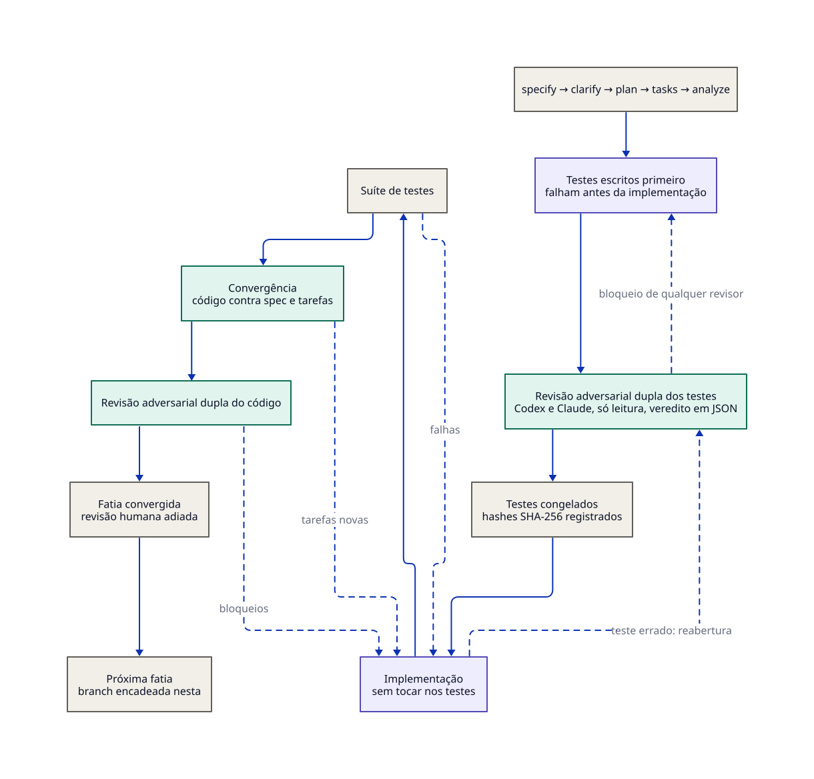

# O método de desenvolvimento

O canal-questoes foi construído com um desenvolvimento guiado por especificação: cada parte do sistema começa por uma
especificação escrita; os testes vêm antes do código e, depois de uma revisão adversarial, ficam congelados; só então
vem a implementação, que não pode mudar os testes. Agentes de código executam o ciclo, o mantenedor do projeto toma as
decisões de escopo, de objetivo e de arquitetura, e a revisão humana de cada parte é adiada para não bloquear a
seguinte.

Este texto descreve o método. As configurações, os roteiros e os prompts que o executam (o kit do processo) não fazem
parte deste repositório; abri-los está no [roadmap](../../ROADMAP.md). Os princípios que o método protege estão em
[Princípios](principios.md), sobretudo o segundo, "Testes primeiro, com revisão adversarial independente".

## As fatias

O sistema foi construído em fatias. Depois dos experimentos iniciais, cada fatia é uma parte vertical do sistema, com
especificação, testes e implementação próprios. Na ordem de execução:

1. experimentos descartáveis, para testar as premissas de maior risco antes de qualquer código de produção, entre
   elas: o motor comparado ao oráculo, as Rich Messages nos aplicativos do Telegram, o identificador de um usuário
   visto por bots diferentes, o conflito entre consumidores do Telegram e as permissões das ferramentas MCP no Claude
   Code;
2. o motor de questões, com a suíte de conformidade contra o PrairieLearn;
3. o núcleo de dados e a API base: a identidade separada, a revelação, o teste canário e as filas;
4. os oferecimentos e os bots: o ciclo de vida, o token cifrado e a posse de cada bot;
5. o vínculo do aluno: a lista da turma, o convite por e-mail e o termo de uso;
6. o disparo e a resposta: as variantes, a entrega, a correção e a janela de resposta;
7. os relatórios e o acompanhamento do professor;
8. a linha de comando, a operação da pilha e o expurgo;
9. a operação por agente: o servidor MCP, as skills e o plugin;
10. a implantação e o piloto;
11. o repositório aberto: esta documentação, os arquivos de comunidade, a qualidade visível no CI e a primeira versão
    pública.

Cada fatia nasce numa branch criada a partir da branch da fatia anterior. As branches ficam encadeadas, e a `main`
avança até a última fatia revisada por uma pessoa.

## O ciclo de cada fatia

1. **Especificação.** Os artefatos vêm primeiro, feitos com o
   [spec-kit](https://github.com/github/spec-kit), uma ferramenta de desenvolvimento guiado por especificação, na
   versão 1.0.11, fixada: a especificação, os esclarecimentos, o plano, as tarefas (sempre com tarefas de teste) e uma
   análise de consistência entre eles. As ambiguidades são resolvidas pelos documentos de arquitetura e
   de decisões; o que não se resolve fica marcado para a revisão humana, sem bloquear o avanço.
2. **Testes primeiro.** Os testes são escritos antes da implementação e precisam falhar, porque ainda não há código
   que os satisfaça.
3. **Revisão adversarial dupla dos testes.** Dois agentes independentes, de modelos diferentes, revisam os testes em
   paralelo, só com permissão de leitura e com o veredito estruturado em JSON: o Codex CLI, num sandbox somente
   leitura, e um agente Claude novo, sem acesso à conversa de quem escreveu os testes. Um bloqueio de qualquer um dos
   dois faz os testes voltarem para ajuste; as sugestões ficam registradas. Há um limite de iterações: ao atingi-lo, o
   caso vai para decisão humana.
4. **Congelamento.** Aprovados, os testes ficam congelados: os hashes SHA-256 dos arquivos de teste e dos contratos são
   registrados, e qualquer alteração posterior é detectada.
5. **Implementação.** A implementação prossegue até a suíte de testes passar, sem tocar nos testes. Se quem implementa
   concluir que um teste congelado está errado, a única via é reabrir a revisão dos testes.
6. **Convergência.** O passo de convergência do spec-kit compara o código com a especificação e as
   tarefas e acrescenta como tarefas novas o que ainda falta construir. A implementação continua até não faltar nada.
7. **Revisão adversarial dupla do código.** Depois da convergência, o código da fatia passa pela mesma revisão dupla.
   Um bloqueio volta para a implementação. A revisão do código entrou no método a partir da fatia do disparo e da
   resposta; o código das fatias anteriores passou depois por uma revisão retroativa única, também dupla. O segundo
   revisor dos testes (o agente Claude) entrou na mesma época: até ali, os testes eram revisados só pelo Codex.
8. **Fatia convergida.** A fatia fica pronta na branch dela, e a fatia seguinte parte dessa branch.

## A revisão humana adiada

A revisão humana de uma fatia é adiada e não bloqueia a seguinte. Uma branch convergida não é reescrita: os ajustes
pedidos na revisão entram no topo da pilha de branches, como mudança nova, e a `main` avança até a última fatia
revisada.

## Quem faz o quê

A execução do ciclo é autônoma: agentes de código (o Claude Code) escrevem os artefatos, os testes e a implementação,
acionam as duas revisões e rodam as suítes, seguindo um roteiro escrito. O mantenedor do projeto toma as decisões de
escopo, de objetivo e de arquitetura, decide os casos que chegam ao limite de iterações e faz a revisão humana.

Toda decisão fica registrada, com o autor e a data. Um registro nunca é apagado: uma revisão ganha registro novo, que
aponta o anterior. Nos documentos de trabalho do repositório de origem, as afirmações vêm marcadas como fato com
fonte, inferência ou decisão, e resposta de modelo de linguagem não conta como fonte.

## O que fica no repositório de origem

Este repositório público é uma exportação do repositório de origem, onde o desenvolvimento acontece. Os registros do
método ficam lá e não são publicados nesta versão: as especificações de cada fatia, os vereditos das revisões, as
listas de hashes dos testes congelados e o registro de decisões. As principais decisões estão resumidas em
[Decisões de projeto](decisoes.md).

Os dois scripts do congelamento estão neste repositório: `scripts/check-frozen-tests.sh`, para a suíte Python e os
contratos, e `scripts/check-frozen-engine-tests.sh`, para os testes do motor. Cada um confere uma lista de hashes
SHA-256 e falha se um hash não confere, se a lista de arquivos mudou ou se há arquivo novo, alterado ou não rastreado
nos caminhos congelados. As listas que eles leem ficam com as especificações, no repositório de origem.

## Para quem contribui

Quem contribui por pull request segue as mesmas regras, sem precisar do kit: os testes vêm antes do código, e um teste
existente não muda para o código passar. Como rodar as suítes está no [`AGENTS.md`](../../AGENTS.md); as regras de
contribuição, inclusive a política para contribuições feitas com IA, no [`CONTRIBUTING.md`](../../CONTRIBUTING.md).
